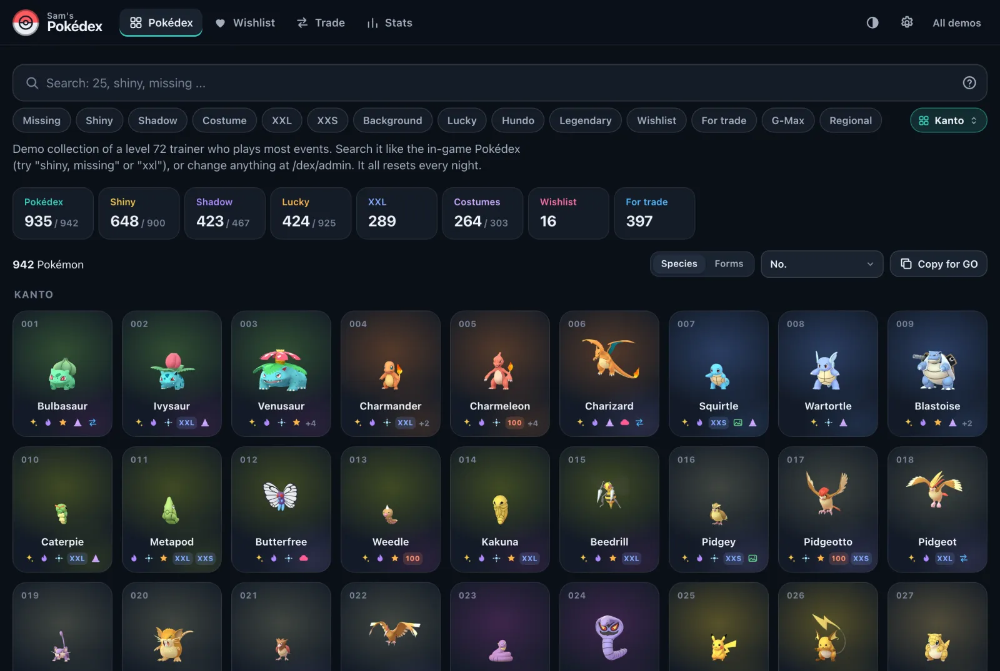
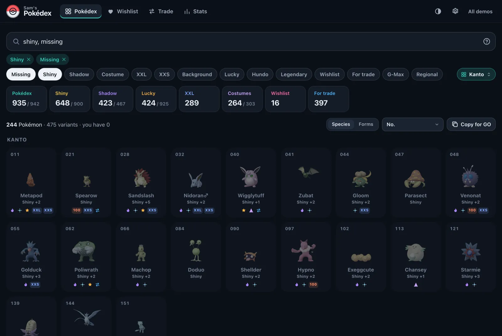
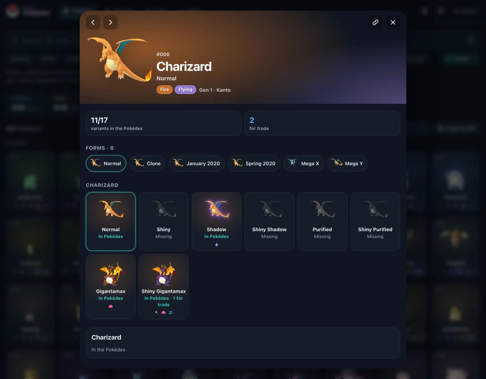
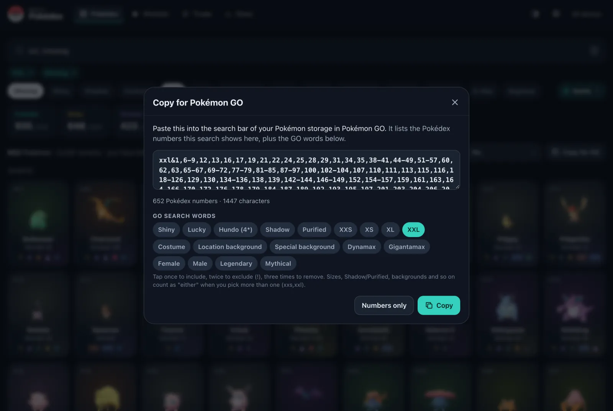
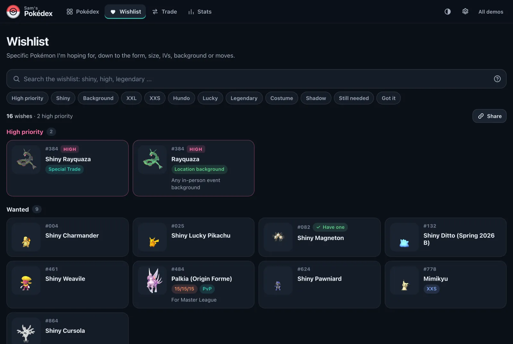
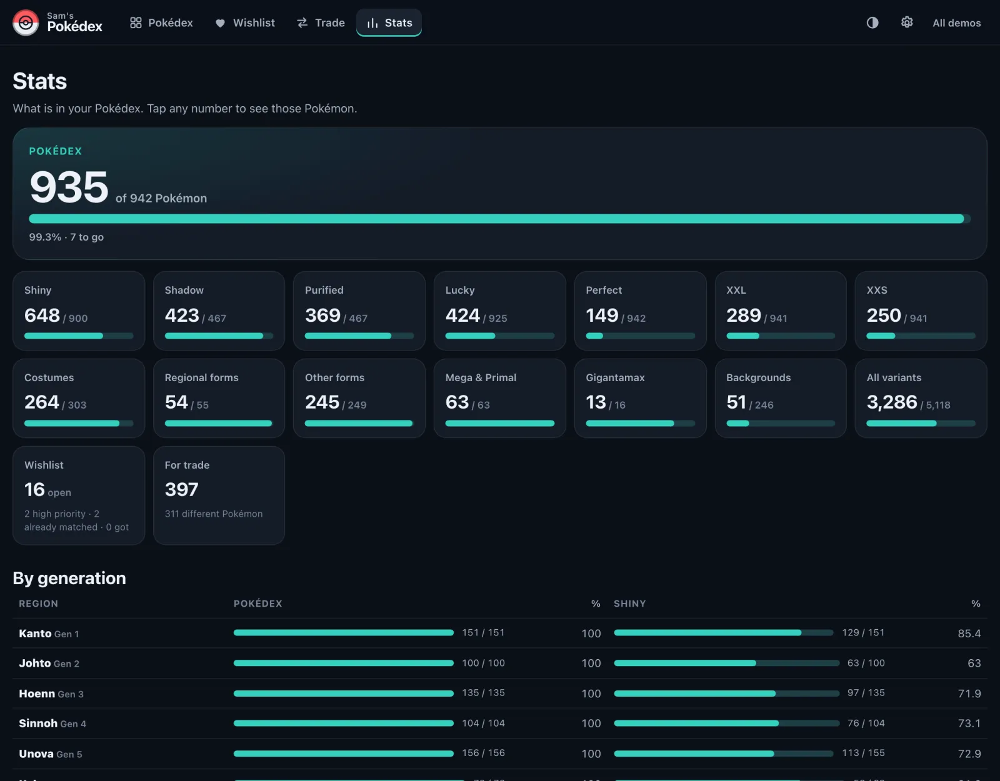
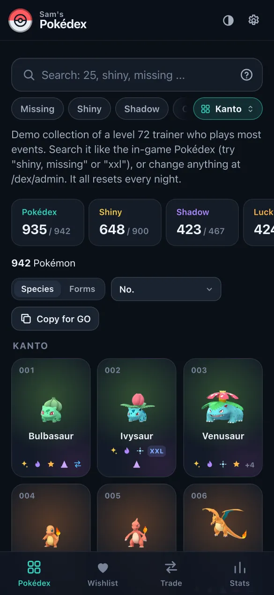

# godex

A searchable Pokémon GO collection Pokédex you can host yourself. It shows what is in your Pokédex, what you
are missing, what you want and what you have for trade, down to the level of "shiny XXL Pikachu with the
Madrid background".

The public page is read only, so you can send people a link instead of answering "do you have this shiny?"
for the hundredth time. Editing happens on a private admin page that works well on a phone, so you can
update it while you play.

Not affiliated with Niantic, Scopely, Nintendo, The Pokémon Company or GAME FREAK. No Pokémon images are
included (see [Images](#images)).

**Try it:** [mubar.uk/dex](https://mubar.uk/dex/) is a public demo with a made-up collection (a level 72
trainer who plays most events). Anyone can edit it at `/dex/admin`, and it resets every night.



## What it does

* **Pokédex** grid that feels like the in-game one: silhouettes for what you don't have, type-tinted cards
  for what you do, small icons for shiny, shadow, lucky, XXL, backgrounds, costumes, wishlist and trade.
* **One simple rule**, like the game: if it's in your Pokédex, you have it. Costumes, forms and backgrounds are
  all on each Pokémon's own page.
* **Variant-level records.** Every form, costume, regional form, Mega, Gigantamax, shiny, Shadow and Purified
  version is tracked separately, and each individual Pokémon can carry size, lucky, IVs, background, gender,
  moves, CP and notes.
* **Search** that works like the game's, with commas and `!`:
  `1-151, shiny, missing` · `pikachu, costume` · `xxl, shiny` · `legendary, xxl` · `shiny, !shadow` ·
  `background, missing` · `+eevee` · `@special rend` · `bg:madrid`. Every search is in the address bar,
  for example `/dex?shiny&missing`, so you can share exactly what you see.
* **Copy for Pokémon GO**: turn any result into an in-game search string, for example the Pokédex numbers of
  every XXL you are missing plus GO's own words: `xxs,xxl&shiny&1-3,7,25`. Paste it into your Pokémon storage.
* **Wishlist** as its own page: wish for a specific variant with requirements (shiny, lucky, hundo or minimum
  IVs, XXL/XXS, a background, moves, gender, tags like PvP or Special Trade) and a priority. It tells you when
  something you own already matches.
* **Trade** page: what you can offer (with quantities) next to what you are looking for, plus "copy as text".
* **Backgrounds**: every location and special background in the game as a gallery, the ones you have in colour
  with the Pokémon that carry them. A Pokémon with a background shows the artwork behind it, like the game does.
* **Pokédex entry** on each Pokémon page: category, entry text, height, weight and gender ratio, with the form's own
  height and weight for regional forms and Megas (optional, from a local PokeAPI copy; see Pokémon data).
* **Stats**: Pokédex, shiny, Shadow, Purified, lucky, perfect, XXL/XXS, costumes, forms, Megas,
  Gigantamax, backgrounds and per-generation progress. Every number opens the matching search.
* **Trade compare**: a visitor types what they have and what they want, and sees which of theirs are on your
  wishlist (and what still needs checking, like "needs XXL") and which of their wants you can offer.
* **Admin**: quick toggles (in my Pokédex, for trade -/+), a quick-entry mode where tapping a card marks
  it, special Pokémon, wishes, bulk actions on any search result, paste a list of Pokédex numbers, JSON/CSV
  export, a repeatable JSON import with a dry run ([docs/IMPORT.md](docs/IMPORT.md)), and undo for every change.
* **Phone friendly**: designed for the iPhone first, a floating region picker, Add to Home Screen, and link
  previews when you share a page in a chat.

## Screenshots

| | |
|---|---|
|  |  |
| `shiny, missing`: Pokémon with no shiny yet | Each Pokémon's page: forms, variants, what you have |
|  |  |
| Copy any result as a Pokémon GO search string | The wishlist, with "have one" when something matches |
|  |  |
| Stats: every number opens the matching search | On a phone |

The screenshots are from the demo. The images in them are not part of this repository (see [Images](#images)).

## Quick start

Needs Python 3.11+.

```bash
python3 -m venv .venv && .venv/bin/pip install -r requirements.txt
.venv/bin/python -m godex.cli init            # creates var/dex.sqlite3 and loads data/catalog.json
.venv/bin/python -m godex.cli set-password    # the admin password
.venv/bin/python -m godex.serve               # http://127.0.0.1:8782/dex/  (admin: /dex/admin)
```

To try it with a made-up collection and no password: `scripts/dev.sh --seed`.

Put it behind a reverse proxy with HTTPS. Settings are environment variables, listed in
[.env.example](.env.example). [docs/DEPLOY.md](docs/DEPLOY.md) has a systemd + nginx setup, including the
mode where an existing site login protects the admin pages.

## Images

Pokémon images are copyrighted, so this repository has none. Put your own in `media/sprites/` (the folder is
ignored by git). The easiest source is a Pokémon GO icon dump with the standard file names
(`pm25.icon.png`, `pm25.s.icon.png`, `pm25.fVS_2019.icon.png` ...), such as the PokeMiners `pogo_assets`
"Addressable Assets" folder. `python tools/fetch_sprites.py` downloads the ones the catalog names from a
public mirror for your own use. Anything without an image gets a numbered placeholder.
[media/sprites/README.md](media/sprites/README.md) explains the naming and how to add your own pictures for a
single form.

## Pokémon data

`data/catalog.json` holds species, forms, costumes, Megas, Gigantamax, shadow availability and backgrounds.
It is built from the PokeMiners game master, pokemon-go-api, Leek Duck's shiny list (released shinies per form and
costume) and pogoapi.net, with local fixes in `data/overrides.json`. A server install updates it weekly on its own,
checks it, and lists what was added on the Data page ([docs/DEPLOY.md](docs/DEPLOY.md)); your collection is never
touched by that. If something is wrong for your
purposes (say a costume shiny that was never released), you can also untick "Counts" on that variant in the
admin page.

The Pokédex entry block reads an optional SQLite file built from the [PokeAPI](https://github.com/PokeAPI/pokeapi)
CSV dump (`data/v2/csv`, BSD-3-Clause), set with `DEX_POKEAPI_DB` (default `/srv/pokeapi/pokeapi.sqlite`). It needs
two tables: `en_species (id, identifier, genus, flavor, gender_rate)` and
`en_pokemon (species_id, identifier, is_default, height_dm, weight_hg)` with English text. The file is opened
read-only and can be replaced while the app runs; without it the block is simply left out
([godex/pokedex_facts.py](godex/pokedex_facts.py)).

## How the data is shaped

Species -> forms -> variants (form × shiny × normal/Shadow/Purified × none/Dynamax/Gigantamax) -> entries.
An entry is a Pokémon in your Pokédex, with how many you offer for trade and the per-Pokémon details. Wishes are separate rows where an empty requirement means "any". The full reasoning is in
[docs/SCHEMA.md](docs/SCHEMA.md), and the search language is in [docs/SEARCH.md](docs/SEARCH.md).

## Development

Changes are listed in [CHANGELOG.md](CHANGELOG.md).

```bash
.venv/bin/pip install -r requirements-dev.txt
.venv/bin/python -m pytest        # API, rules, auth modes, import/export
node --test tests/js/*.test.mjs   # the search engine
```

The front end is plain ES modules with no build step and a strict Content Security Policy
(`script-src 'self'`). The search engine (`godex/static/js/query.js`) is a single registry of terms: adding a
search word means adding one object there.

## Licence

MIT, for the code. Pokémon and all related names are trademarks of their owners.
